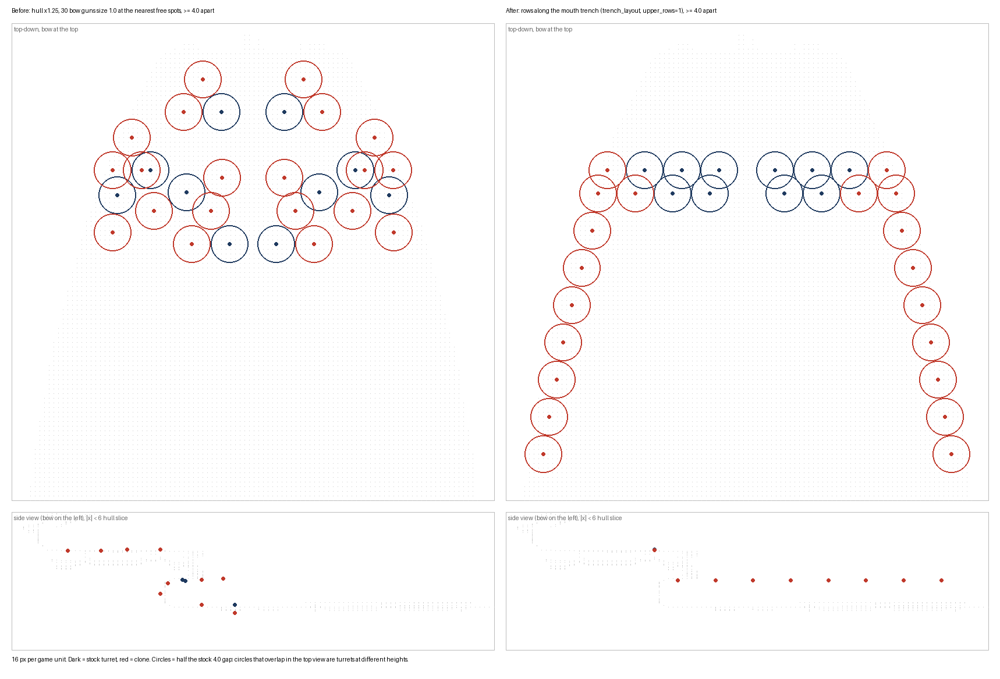

# Scaling a ship and laying out its guns

Findings from the original `Assembly-CSharp.dll` (IL read with `ikdasm`) and the Mercury MK2 bundle. Tooling:
`weapons --ship-scale S`, `--scale SELECTOR=S`, `--respace SELECTOR=GAP` (all in the GUI's bundle form too) and
`deadlock_tools.trench.trench_layout` (bow guns in rows along the mouth trench; Python API, not in the GUI yet).

## How a ship bundle is put together

The prefab root is a GameObject named after the bundle (e.g. `colonialmercurymk2`) carrying `ShipInfo`,
`ArmourInfo`, `PropulsionInfo`, the subsystems and modules. Its `Transform` has these children: `Actions` (radial
menus), `Model`, `Weapons` (one child per quadrant: `Fore`, `Rear`, `Port`, `Starboard`, `Dorsal`, `Ventral`, each
holding `WeaponMountPoint` objects), `SubSystems`, `WeaponTargets`, `LaunchPoints`, `BoardingPoints`,
`CollisionZones`, `Engines`, `ShipNamePlates`, the wreck mesh and `Pickable`. Extra roots in the same bundle (stealth
effects, decals) aren't part of the ship hierarchy.

## What scales with the root Transform, and what doesn't

| Data | Scales with the root? | Why |
|---|---|---|
| Model, collision zones, launch/boarding points, engines | yes | children of the root |
| Weapon mount **positions** | yes | children of `Weapons/<quadrant>` |
| **Turret size** | yes, unless compensated | `ShipInfo` spawns each turret from `WeaponFactory` at the mount's position/rotation, `set_parent(mount)`, then `localScale = (MeshScale, MeshScale, MeshScale)`, so it inherits every parent scale |
| `WeaponsTarget` hit points and miss points | yes | read through `transform.TransformPoint` |
| `ArmourInfo.quadrantScale` / `quadrantOffset` | yes | the hit position is converted with `InverseTransformPoint` before the quadrant test |
| `WeaponsTarget.missSphereRadius` | **no** | added after `TransformPoint`, a world distance |
| `ShipInfo.CollisionExclusionZoneRadius` | **no** | world distance; deployment spacing reads the **ship database** copy (`ShipDataTableObject.CollisionExclusionZoneRadius`) |

`--ship-scale S` therefore:
1. sets the root scale to S (absolute: 1 = stock, so repeating it changes nothing; non-uniform roots are refused)
2. divides every weapon mount's Transform scale by the change, so turrets keep their size and `MeshScale` keeps meaning
   "turret size"
3. multiplies `CollisionExclusionZoneRadius` and `missSphereRadius` by the change

Also set the ship-database `CollisionExclusionZoneRadius` to the same value (Ships page) so fleets deploy with the
right spacing. Not scaled: the war-room fleet icon model (`FleetModelFactory` in level5/level85) and the hologram
projection; they're separate prefabs.

## Turret spacing

Stock full-size turrets on the Mercury bow are 4.0 game units apart at their closest. Cloned turrets (`<name>_x2`,
`_x3`, made by `--clone`) were packed 2.0 apart at `MeshScale` 0.7. `--respace fore=4` moves the existing clones (originals
stay put) to the nearest free hull spot that is at least the gap from every other turret. Each clone keeps its
original's height above the hull mesh and its rotation, and mirror twins are placed together. The gap is in game
units after `--ship-scale`.

Mercury MK2 (November 2026): hull ×1.25, all 30 bow turrets back to size 1.0, closest pair 4.00. The respaced layout
was then replaced by the trench rows below (the picture there shows both).

## Bow guns in the mouth trench (Mercury MK2)

`deadlock_tools.trench.trench_layout(src, dst, selector="fore", gap=4.0, upper_rows=1, floor_rows=None)` lays the bow
guns out in rows along the mouth of the Mercury's alligator-head bow. The geometry, read from the MK2 hull mesh
(`build_hull_query`, local units; ×1.25 for game units):

* **Upper jaw underside**: flat at y ≈ −1.25 from z 77 to the snout (z ≈ 90). Its width shrinks towards the snout:
  |x| ≤ 12.5 at z 80, ≤ 10 at z 86, ≤ 8 at z 90. Everything ahead of z 80 is an overhang with nothing below it.
* **Trench floor** (top of the lower jaw): y ≈ −3.6, but across the ship only in a narrow band at z 76.6–79.6. The
  lower jaw ends at z ≈ 80. The mouth is open between y −3.6 and −1.3, 2.3 units tall.
* **Side grooves**: behind z 77 the hull is solid from the belly (−6.1) to the deck (+7…+9) for |x| < 13. The mouth
  continues back along each side as a groove ~2 units wide with the same floor (−3.6) and roof (−1.3). It runs
  diagonally outwards from x ≈ 13.5 at z 76 to x ≈ 18 at z 45, and ends around z 30. This is the jaw line.
* Stock fore turrets: 4 on the upper underside (y −1.1/−1.2, z 80.6 and 85.6), 4 on the trench floor (y −3.7/−3.8,
  z 78.5–78.7) and a pair on the belly (y −5.9 over the −6.1 bottom, z 74.3). Every stock turret's pivot sits
  0.03–0.2 units *inside* the surface it is on, and they all have the identity rotation. The upper ones hang upright
  under the jaw.

How the layout is built:
1. The stock (non-clone) turrets are grouped by the hull surface nearest to each. The two groups with the most stock
   turrets are the mouth: the higher one is the upper lip, the lower one the floor. The belly pair has its own lip, so
   it gets moved into the mouth. Each lip keeps its median height offset, rotation and `InitialAngles`.
2. Rows run across the ship, `gap` game units apart (3.2 local at ×1.25). Floor row 1 goes through the front stock
   floor turrets (z 78.59); further floor rows step back 3.2 at a time. Behind the open front only the grooves have
   floor, so each of those rows is one mirrored pair, and together they run back along the jaw line. Upper row 1 sits
   where its 3D gap to floor row 1 is exactly `gap` (z 80.58, which is also where the stock upper pair already sits);
   further upper rows step forward under the snout.
3. A spot counts only if the lip is there (±0.25) at the spot and 0.5 units around it, on both sides (x and −x).
   Within a row, spots are `gap` apart and mirrored. The phase that fits the most spots wins, then the one through
   the stock turrets.
4. Spots are filled from the centre of the mouth outwards in mirrored pairs. A centre-line spot is skipped when it
   would leave one turret without a pair. The spots also keep `gap` from all other turret groups. Stock turrets
   already on a spot stay put. Every fore turret gets `MeshScale` 1.0. If the trench has fewer spots than turrets,
   the extra clones (highest `_xN` first) are removed with their GameObjects: parent `m_Children`, the AssetBundle
   preload table and a dangling-reference check, as in `bays.apply`. If it has more, the outer spots stay empty.
5. `trench.check(path)` re-reads the bundle (`bundle_mount_layout`). It verifies `MeshScale`, the closest 3D pair,
   distance to other groups, mirror symmetry and distance to the hull surface.

Result installed in the work tree (backup `work/.deadlock-tools/backups/mk2-trench-20261124-073147`): 30 turrets, none
removed. Upper row z 80.58: 8 guns at x ±1.6 … ±12.0. Floor row z 78.59: 8 at ±3.2 … ±12.8. Then 7 mirrored pairs
down the side grooves (z 75.4 to 56.2, x ±13.3 to ±17.0). Closest pair 4.00 game units, nearest other turret group
33.4, largest pivot-to-surface distance 0.17, all `MeshScale` 1.0.

`upper_rows=2` gives a more compact mouth: 15 under the jaw (8 at z 80.58, 7 at z 83.78), 9 across the floor
including one on the centre line, and 3 pairs down the grooves to z 69.0.

(Redraw with `trench.draw_comparison(before, after, png)`, which needs Pillow. Top-down: circles that overlap are
turrets at different heights; the 3D gap is at least 4.0. Side view: the bow is on the left.)
